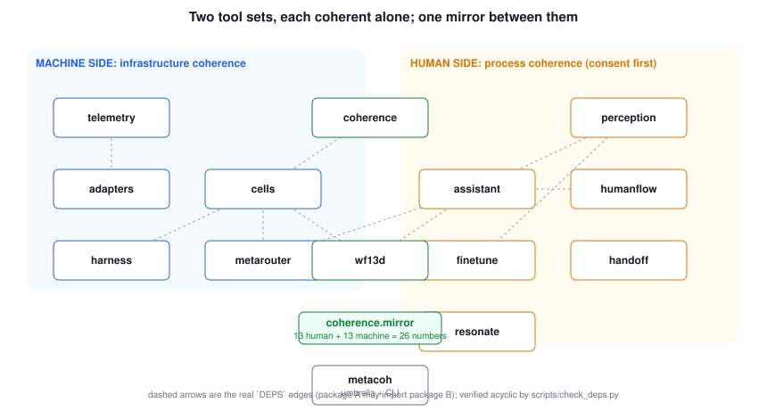
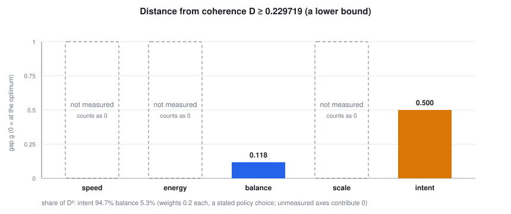

# Meta Coherence Hive (working title)

A system that tells you **how far you are from coherence**, in numbers you can check, and then helps each small agent (and each person) move the right way. It has two tool sets, each coherent alone: one for **infrastructure**, one for **human process** (consent first, every person owning their own data). They meet in a mirror that compares where each side is paying attention. Every learned model it uses is a **Meta model**, reached through one gateway.



## The problem, as one number

A person who has chosen a direction cannot see their own location. Here that location is a number: the distance from coherence **D**. For one recorded three-node cluster it is at least **0.2297**, and it is a lower bound because three of its five axes have no instrument yet [C:distance-lower-bound]. About 95% of that distance is *intent*, the system not knowing what its human wants, not the machines [C:intent-dominates-D]. See [docs/STORY.md](docs/STORY.md) for the whole story and [docs/figures/](docs/FIGURES.md) for every figure.



## Every claim is a check

Each number in these docs carries a tag like [C:release-gates] that names a check which can fail. `docs/CLAIMS.md` lists them all with their evidence; `scripts/docs_lint.py` fails the build if a number appears without a tag.

```
python scripts/verify_claims.py --require-all
python scripts/docs_lint.py
python scripts/make_figures.py --check
```

## Install

```
tar xzf metacoh-0.1.0-linux-x86_64.tar.gz && cd metacoh-0.1.0
installer/install.sh --user && ~/.local/share/metacoh/bin/metacoh doctor
```

Offline, hash-pinned, rollback-safe, with an uninstall receipt: see [docs/PACKAGING.md](docs/PACKAGING.md). From source: `python scripts/run_all_tests.py`.

## What is in it

| Package | What it does |
|---|---|
| `wf13d` | the WF-13D bridge arithmetic as one 18-bit word, plus a binary lookup table any language can embed [C:wf13d-exhaustive] |
| `coherence` | D and its gradient, the attention mirror and 4-cube, attention and signal tracking, Langton's-ant escape direction (run until locked), ant-colony search, cache-to-cache gossip |
| `metarouter` | Meta-only policy; routing by time to a verified result, including queueing |
| `harness` | staged rollout with a control group, signed outer boundary, provenance, question stream, agent DAG validator |
| `telemetry`, `adapters` | the telemetry store and the only environment-specific code (a read-only inventory sampler) |
| `cells` | a micro cell: WF-13D gating, policy, routing, provenance |
| `perception`, `humanflow`, `assistant`, `finetune` | consent-first capture, owner-only time ledger with private roll-ups, a focus-respecting assistant, a consent-gated fine-tuning gate |
| `handoff` | an expert's work as a verified procedure graph: find gaps, ask one question each, guide a trainee; step scoring with its threshold curve and its blind spots ([docs/SCORING.md](docs/SCORING.md)) |
| `resonate` | present a measurement in the form this person understands; a tone whose beat vanishes when both sides agree |
| `metacoh` | umbrella package and the `metacoh doctor` self-check |
| `crates/` | Rust ports of the hot paths with a C ABI, checked bit for bit against Python [C:rust-conformance] |

Packages are isolated: each lists the siblings it may import in `DEPS`, and the build fails on anything else [C:release-gates].

## Privacy in one paragraph

Capture is off until a person turns it on for a named source and purpose, for a limited time, and they can revoke it mid-stream [C:consent-default-deny]. Raw frames are described, redacted and dropped; the event type has no field for pixels [C:no-raw-media-stored]. A person's ledger is readable only by that person [C:owner-only-ledger]; group views need at least five contributors and add noise [C:rollup-privacy]. Read [docs/PRIVACY.md](docs/PRIVACY.md), including what is **not** built yet.

## Honest status

Mechanisms are implemented and checked on synthetic data. No real person has been recorded, no live Meta model call is made by the tests, no wearable SDK adapter exists, and nothing here changes a real cluster. The Handoff success criterion (real recorded jobs) is not yet measured; see the table in the story.

## Licensing and the hackathon

Apache-2.0. See [docs/LICENSE-AND-TERMS.md](docs/LICENSE-AND-TERMS.md) for how the license fits the Official Rules, and [docs/HACKATHON.md](docs/HACKATHON.md) for the models used and a per-component authorship table.
