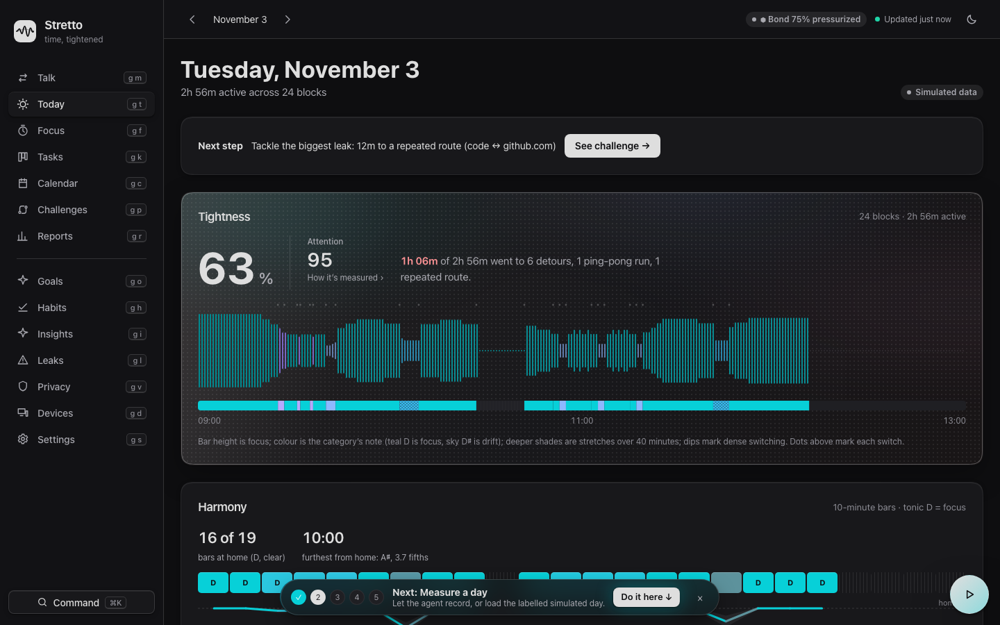
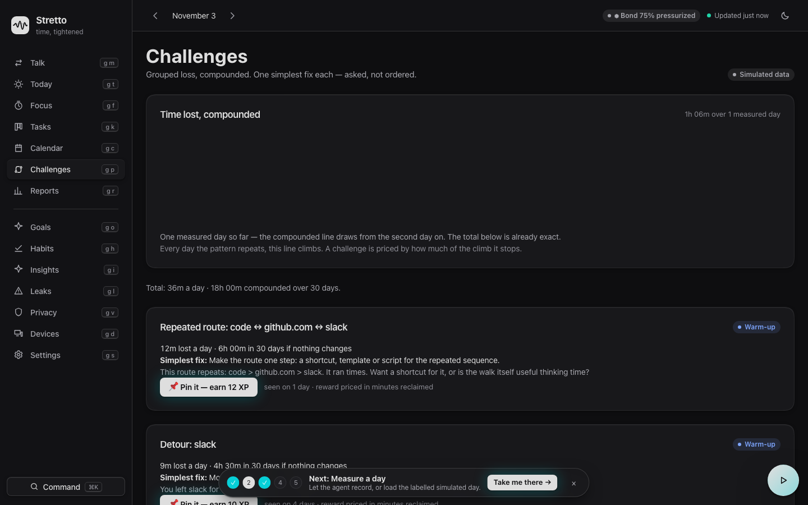

# Stretto user guide — every interface, state by state

Screenshots are real captures of this build on the simulated day (`docs/screens/`). Simulated data is
labelled as such in the app and in this guide. Signal key, used everywhere:

| Signal | Meaning | Trust level |
|---|---|---|
| No pill | Measured, from your blocks | Highest |
| Simulated data | Generated demo day | Illustrative only |
| inferred | Phrased by the Meta model | Opinion, cited |
| ⬢ Bond % | Install lock pressure | Live check |

Global furniture on every page: left nav (keyboard letter per page, `⌘K` palette), date stepper,
Bond pill, Live/Updated status, the bottom guiding light (five steps, dismiss per day), and a ramped
load bar with percentage on slow loads. If you ever wonder what to do: the light at the bottom is lit
on exactly one next step, and that step's button pulses on its page.

## Today — the mirror

- **Purpose:** Tightness, attention, the day's wave, where time went, findings.
- **States:** Empty (one action: record or load simulated) · Measured (hero, wave, harmony, findings) ·
  Simulated (pill shown) · Live (SSE updates without refresh).
- **Help:** "How it's measured" expands every definition. "See challenge →" is the one next action.
- **Still needs development:** Attention readout is textual where other ratios are drawn.

## Challenges — grouped loss, compounded

- **Purpose:** Patterns grouped over 30 days, priced per day and compounded, one simplest fix each.
- **States:** No challenges yet · Cards by tier (Warm-up → Stretch) · Pinned (waits for a clean day,
  then pays XP automatically) · Evidence disclosure (route field, findings, every move) below.
- **Help:** Each card asks its question Socratically. Accepting is "Pin it", never an order.
- **Still needs development:** Compounded line needs two measured days; XP pays on pattern absence,
  not on verified behaviour change.

## Focus — the ring

- **Purpose:** 25/50/90-minute timer bound to a task or none.
- **States:** Idle (Start focus is the pulsing target) · Running (ring counts, header pill everywhere,
  shared clock on other devices) · Break · Stopped = counted. Nothing is guessed.
- **Still needs development:** No pause; stop-and-restart is the honest substitute.

## Tasks — and Topics & Recall

- **Purpose:** Tasks (list/board), projects, estimates; above them, semantic recall across tasks,
  challenges, insights and conversations, with folded topic buckets.
- **States:** Recall empty ("Nothing recalled for that yet") · Scored results with match %.
- **Still needs development:** Recall ranks text, not outcomes; accepted suggestions are not yet tracked.

## Calendar — rings, planning, connections

- **Purpose:** Month of goal rings, a day's measured timeline, plan a task onto a morning.
- **States:** Measured day (ring) · Planned (marker) · Connections card: Google, iCloud, Microsoft
  each "ICS ready", or "Live sync configured" only when credentials truly exist.
- **Help:** Export `.ics` (planned tasks + sessions) or import any `.ics` into planned tasks.
- **Still needs development:** Live OAuth/CalDAV sync itself; ICS is the shipped bridge.

## Reports — the week, counted

- **Purpose:** 7/30-day trends, category split, hour-by-day heatmap, best focus window.
- **States:** Scrubbable trend (hover, arrows, End) · Simulated pill when demo days are in range.
- **Still needs development:** No export/share yet.

## Goals — aim, horizon, rank

- **Purpose:** Daily goal slider, weekly rings, budgets, coach horizon, level/rank/streak.
- **States:** Coach ramp steepens after a met week (+15%) and eases after two missed (−10%),
  set in Settings. Rank ladder Starter → Stretto.
- **Still needs development:** Met/missed weeks are self-reported in Settings, not auto-detected.

## Habits — one tap

- **Purpose:** Named practices on an 8-week, 56-cell grid. Start small; miss and the truth waits.
- **States:** Today one tap away (`T`). No streak punishment for an unfinished today.

## Insights — the mirror speaks

- **Purpose:** Meta headline + up to four actions over measured findings, the facts they saw,
  dropped-output counts, and the full model-calls ledger.
- **States:** Needs consent → Needs key (`no_model_access`, structured) → Generating → Ready
  (always pill-labelled inferred) · Cached (honeycomb twin, no new spend).
- **Help:** Every action cites a finding; open it to check the minutes yourself.

## Leaks — compounding, ranked

- **Purpose:** Leak score and the ranked changes from the voice runtime's leak analysis.
- **States:** Shares Challenges' inputs; Challenges is the canonical grouped view.

## Talk — voice, questions first

- **Purpose:** Speak or type; the derivable decision tree for today is preloaded with its graph
  and grounded cached reply, so the first answer needs no model call.
- **States:** Idle · Listening · Thinking (which path: instant/grounded/model) · Speaking.
  Finished turns persist and join Topics & Recall.
- **Still needs development:** Speech runs through the Humanflow voice runtime on :8788; the tree
  and coaching are local, the ears are a separate service by design.

## Privacy — consent, as a mechanism

- **Purpose:** Five notice families, single-form acceptance, per-family revoke and purge.
- **States:** Not accepted · Accepted (granted by, when, version) · Changed notice (earlier grants
  invalidated) · Chain intact / check failed pill, always visible.
- **Help:** "Purge kept data" needs the typed `DELETE <family>` phrase. The server refuses data
  for any family without an active grant, whoever sends it.

## Devices — computers that report here

- **Purpose:** Enrolment codes, device keys, permission plans with exact fix commands, agent bundles.
- **States:** This device · Enrolled · Revoked (key dead) · Permission needed (the OS prompt owns approval).
- **Still needs development:** Wayland collector agent (X11 today).

## Settings — your world, your rules

- **Purpose:** Goal, theme, classification rules, budgets, coach horizon, Meta model, host storage.
- **States:** Saves as you move/type · Model must be a Meta model or the server refuses it ·
  Untick "Save full detail" for distilled storage (titles/domains dropped on the host).
- **Help:** Rules define focus for your work; changing them recomputes history and says so.

## Known issues found by walking this build (2026-11-04)

- **Fixed during the walk:** app failed to boot from an unimported `api` in the bond pill (caught by
  headless screenshot); Talk tree rendered a literal "null"; challenge titles rendered
  "[object Object]"; single-day compounded chart drew nothing without explanation; the model
  gateway returned a bare 500 instead of a structured refusal.
- **Open, by design or backlog:** guide bar can overlap the lowest card on short viewports;
  Challenges XP pays on pattern absence; coach met/missed weeks are manual; Calendar live sync is
  ICS-only until credentials exist; Talk depends on the :8788 voice runtime; no remote-mode TLS yet
  (documented in Settings' threat notes); simulated pill placement is complete on finding pages
  and range pages, and aggregate headers inherit the range flag.
