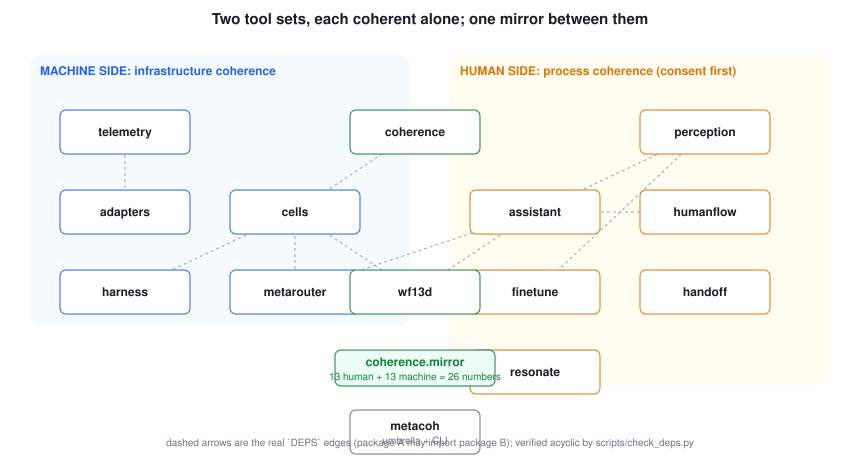
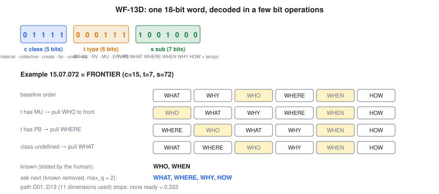
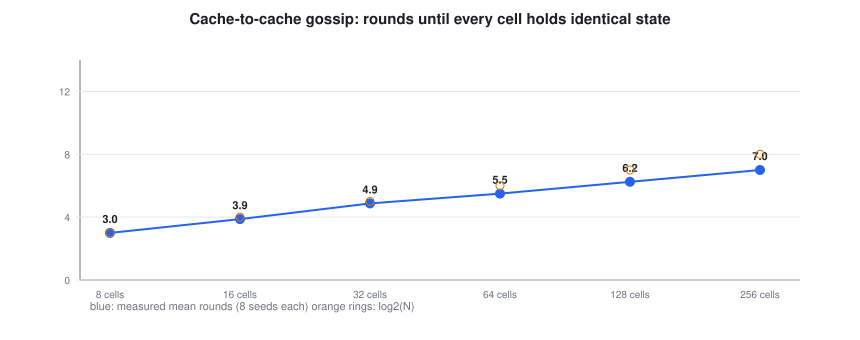

# Architecture

One loop runs at two scales, for a cluster and for a person: **measure, compute the distance from coherence (D), let its gradient say which action lowers D fastest per unit cost, act inside a boundary, verify against a control group or the person's own confirmation, record provenance.**

## The pieces and what each guarantees

**WF-13D (intent).** An address is one 18-bit word; the question list, the reasoning path and the stops come from a few bit operations. The arithmetic reproduces recorded outputs of the original tool [C:wf13d-recorded-tool] and a packed table decodes identically at every address [C:wf13d-exhaustive].

**Distance from coherence (D).** Speed, energy, balance, scale and intent gaps, each between zero and one. An unmeasured axis contributes zero, so with missing axes D is reported as a lower bound [C:distance-lower-bound]. A cell takes the action whose expected effect lowers D fastest per unit cost, and holds still near coherence [C:direction-follows-gradient].

**Routing (Meta models only, through one gateway).** The router picks the endpoint that finishes soonest: service time plus queueing delay, comparing a sequential cascade with racing the top endpoints. The queueing formula matches the closed form [C:erlang-c-values] and the race formulas match a simulation [C:route-formulas-match-simulation]. Models that are not allowed Meta models are refused [C:meta-only-policy]. The interactive Muse subscription is for testing; a router in `prod` mode excludes it.

**Rollout harness.** A change goes to a canary, then a small group, then the rest, each stage compared with an untreated control group; a held-out control is promoted last. In simulation a change with no effect is almost never promoted and a real one almost always is [C:rollout-gate-simulation]. Every change traces from the ledger to a decision, its evidence and the policy; tampering is detected [C:provenance-detects-tampering]. The outer boundary needs two agent signatures and one human signature, and fails closed otherwise [C:boundary-multisig].

**Cells and the swarm.** A cell gates work on WF-13D readiness and stops, then routes, then records provenance with its attention focus and stated intent. Cells search action graphs with an ant-colony method [C:aco-finds-optimum], break ties with Langton's ant run until it provably locks [C:ant-empty-grid], or report NOT_LOCKED when a step cap passes first [C:ant-cap-is-explicit], and keep a shared view by gossip [C:gossip-converges-fast].

**People side.** Consent-first capture, redaction, an owner-only ledger, and private roll-ups: see [PRIVACY.md](PRIVACY.md). The assistant makes no model call without consent, holds suggestions during focus and keeps an hourly budget [C:assistant-respects-focus-and-consent]. **Handoff** turns a procedure into a verified graph and finds missing steps [C:handoff-removal-flagged].

**The mirror.** Both sides keep a 13-number attention vector over the loop dimensions; their agreement is `1 - JSD/ln 2` [C:mirror-properties]. Four yes/no axes reduce to one of sixteen states of a 4-cube [C:tesseract-counts].

## Rules that hold everywhere

- Meta models only, through one gateway in production.
- Nothing irreversible without a human: rollout classes A (automatic, reversible), B (needs approval), C (never automated).
- Provenance for every change and a consent grant for every person-facing event.
- Isolation: `packages/*/DEPS` is the allowed import list, enforced in the build [C:release-gates].
