# Figures

Every figure is generated from the code and recorded data by `python scripts/make_figures.py` and checked for staleness by `--check` [C:figures-current]. None is hand-drawn.

| Figure | What it shows | Backed by |
|---|---|---|
| 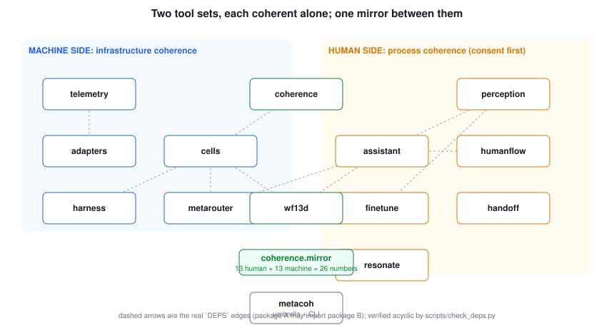 | **The system.** Two tool sets and the mirror; arrows are the real package dependencies | [C:release-gates] |
| 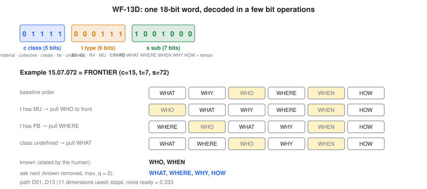 | **WF-13D.** One 18-bit word; the ask order for a worked address, step by step | [C:wf13d-recorded-tool] |
| 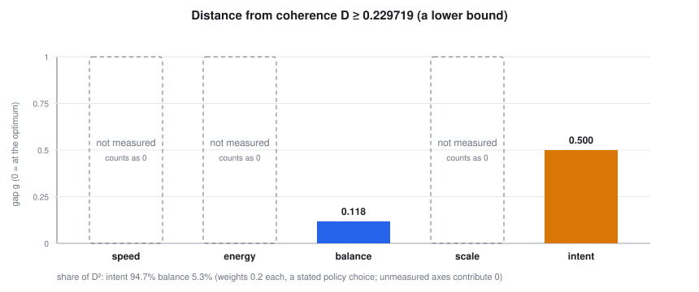 | **The problem as a number.** Distance from coherence for the recorded cluster; unmeasured axes drawn as empty | [C:distance-lower-bound] [C:intent-dominates-D] |
| 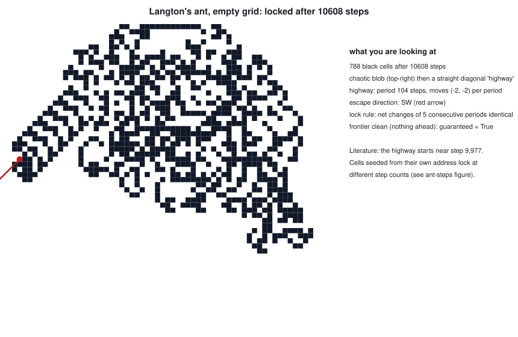 | **Escape direction.** Langton's ant at the moment it locks into its highway | [C:ant-empty-grid] |
| 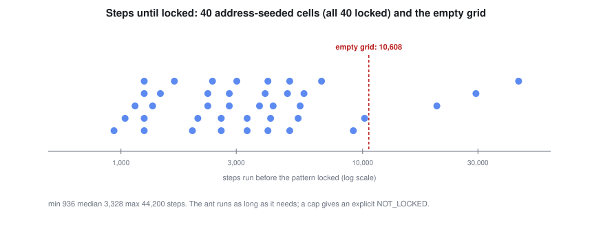 | **How long locking takes.** Steps needed by each address-seeded cell | [C:ant-seeded-cells] |
| 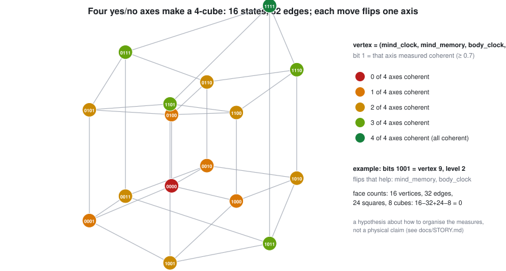 | **Four-axis state.** The 4-cube of coherence states, coloured by how many axes are coherent | [C:tesseract-counts] |
| 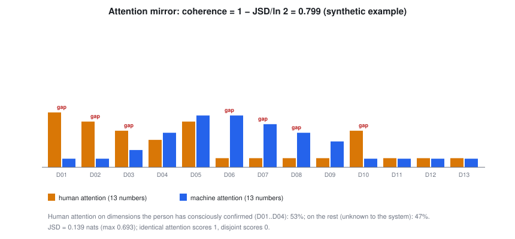 | **The mirror.** Human and machine attention over the 13 loop dimensions, and where they disagree | [C:mirror-properties] |
| 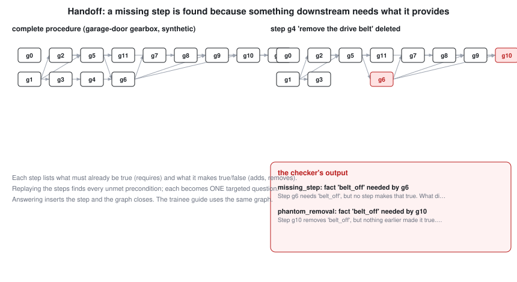 | **Handoff.** A procedure as a graph; a deleted step and the gap the checker reports | [C:handoff-removal-flagged] |
| 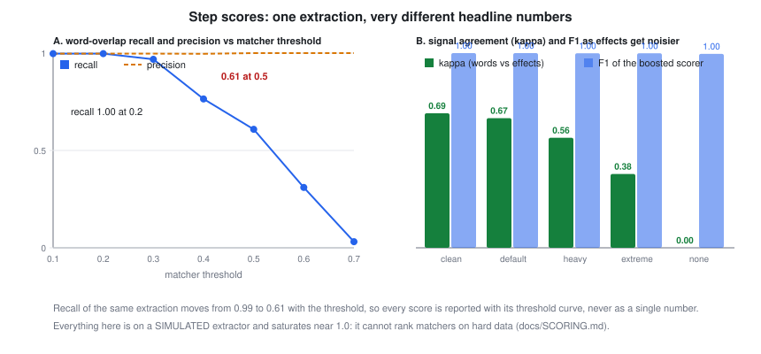 | **Step scores.** One extraction scored at different matcher thresholds; agreement between the two signals as effects get noisier | [C:step-score-threshold-swing] [C:step-signal-agreement] [C:step-score-booster-safe] |
| 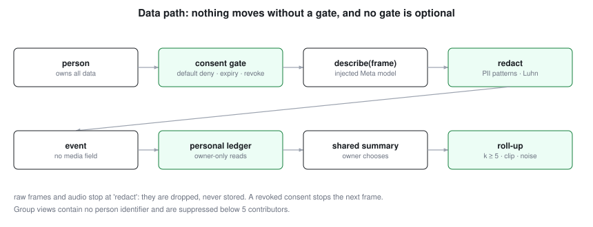 | **Privacy.** Every arrow passes a gate; each gate has a test | [C:consent-default-deny] [C:rollup-privacy] |
| 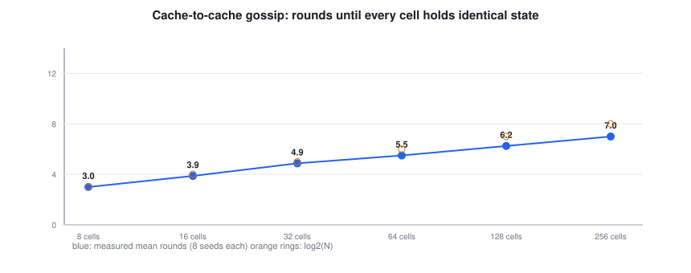 | **Cache to cache.** Rounds for all cells to hold identical state, versus number of cells | [C:gossip-converges-fast] |
| 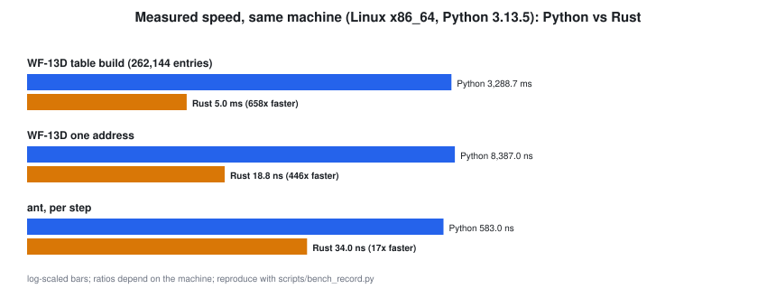 | **Native speed.** Python versus Rust on the same machine | [C:rust-faster] |
| 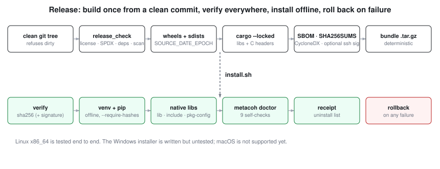 | **Release.** From a clean commit to a verified, rollback-safe install | [C:installer-round-trip] |
