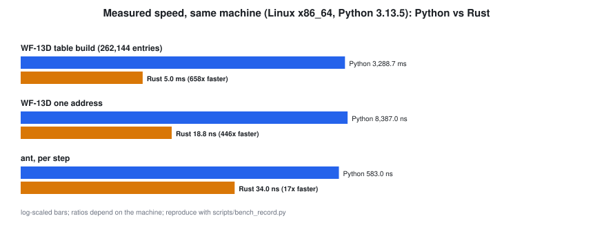

# Native runtime (Rust crates, C ABI)

"Write everything in C or C++ and wrap it in Rust" would add a layer without adding speed. The plan is **Rust-first core crates with a stable C ABI**: C and C++ link the crates through the headers; Rust calls an existing C library (SQLite, say) only where a mature library is the point. Python stays as orchestration and as the **reference oracle**: every crate must reproduce Python's recorded outputs bit for bit.

## Built and checked

| Crate | What | Proof |
|---|---|---|
| `crates/wf13d-core` | the WF-13D arithmetic as one function over an 18-bit address (`no_std`-capable) | reproduces the Python table byte for byte and every golden ant line [C:rust-conformance] |
| `crates/ant` | Langton's ant to lock, with the guarantee check | same golden file as Python [C:rust-conformance] |
| C ABI | `wf13d_word`, `ant_run` with headers and pkg-config files | built from a C and a C++ program [C:c-abi-from-c-and-cpp] |

Speed on the recorded machine is in `docs/data/bench.json` and the figure above. The claim we stand behind is the floor, not the headline: the ports are at least ten times faster for the table build and at least five times faster for the ant [C:rust-faster]. Ratios change with the machine; re-run `scripts/bench_record.py`.

## Not yet ported (and why)

| Component | Reason to port | Order |
|---|---|---|
| redaction + consent | runs on the device that sees the screen; Rust's `regex` has no catastrophic backtracking | next, privacy-critical |
| hash chain, Ed25519 verify | small audited surface | next |
| periodogram / pattern tests | FFT plus many shuffles | later |
| router math, D and gradient, gossip | many cells under a real-time budget | later |
| model calls, orchestration | network-bound, no gain | stays Python |

Targets beyond Linux x86_64 (Android, iOS, WebAssembly) are planned and untested.
