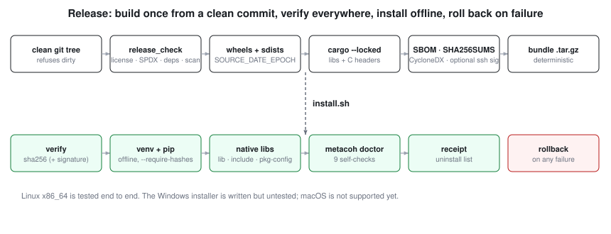

# Packaging and installation

One command builds a release bundle from a clean commit; one command installs it on a machine with no network.



## Build (on a build host, not on a workstation)

```
python -m pip install build
python scripts/package.py --out dist [--sign-key ~/.ssh/release_ed25519]
```

What it does, in order, and refuses to continue on any failure:

1. Refuses a dirty git tree (so every bundle maps to one commit).
2. Runs `scripts/release_check.py`: Apache-2.0 text, SPDX headers, manifests, version equals `VERSION`, no unlisted dependency, package isolation, public-safety scan [C:release-gates].
3. Builds one wheel and one sdist per package with `SOURCE_DATE_EPOCH` set to the commit time, and writes a hash-pinned `requirements.lock`.
4. Builds the Rust crates with `cargo build --release --locked` and collects `.so`, `.a`, C headers and pkg-config files.
5. Writes `SBOM.cdx.json` (CycloneDX), `MANIFEST.json` (commit, versions) and `SHA256SUMS`; signs `SHA256SUMS` with OpenSSH if a key is given.
6. Packs a deterministic `metacoh-<version>-linux-x86_64.tar.gz` (sorted entries, fixed timestamps, uid 0).

## Install (target machine)

```
tar xzf metacoh-0.1.0-linux-x86_64.tar.gz && cd metacoh-0.1.0
installer/install.sh --user                        # or: sudo installer/install.sh --prefix /opt/metacoh
installer/install.sh --prefix P --allowed-signers FILE   # when the bundle is signed
installer/install.sh --prefix P --uninstall
```

The installer verifies every file against `SHA256SUMS` (and the signature when present), creates an isolated virtualenv, installs from the bundled wheelhouse with `--no-index --require-hashes`, installs native libraries and headers, runs `metacoh doctor`, writes an uninstall receipt, and **rolls back everything on any failure**. Re-running it upgrades cleanly. `scripts/test_install.sh` exercises all of this, including a tampered bundle, a broken lockfile and a leftover-file check [C:installer-round-trip].

## Run the installed application <!-- no-claim -->

The installed command is the whole self-hosted application; no source checkout is needed at run time:

```
~/.local/share/metacoh/bin/metacoh gateway    # local runtime; starts keyless
~/.local/share/metacoh/bin/metacoh sensors probe
```

The gateway reads its non-secret defaults, then the owner env file at `~/.config/humanflow/runtime.env` when present, then the process environment. Events and the ledger live under `~/.local/share/humanflow/`. The model registry and the dashboard, voice and settings pages ship inside the runtime wheel, injected and packaged at bundle-build time from their single sources. Open the settings page in a browser to add the model key and to accept or revoke sensing; the sensors agent reads the same consent file.

## What `metacoh doctor` checks

Nine checks, none of which touches the network, a camera or a cluster: distribution versions agree, the WF-13D table checksum and lookup, the ant locking on an empty grid, consent default-deny, the Meta-only policy, the distance-from-coherence arithmetic, the mirror and the 4-cube, Handoff gap detection, and the resonance beat.

## Using the native libraries from C or C++

```
cc app.c $(pkg-config --cflags --libs wf13d-core ant)
```

Headers: `wf13d_core.h`, `ant.h`. A C program and a C++ program are built against them and compared with Python in `scripts/c_abi_smoke.sh` [C:c-abi-from-c-and-cpp].

## Support matrix

| Platform | Python wheels | Native libraries | Installer |
|---|---|---|---|
| Linux x86_64 | tested | tested | tested |
| Windows | not built | not built | `install.ps1` written, **untested** |
| macOS, Linux arm64 | not built | not built | not provided |

Versions are single-sourced from `VERSION`. Releases are not published to PyPI or crates.io by this repository.
