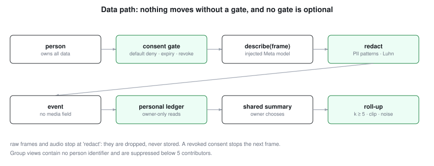

# Privacy and consent design

Screens, cameras, microphones and wearables record people. This design starts from the person, not the organization.

## Rules the code enforces (each is a registered check)

1. **Default deny.** Capture is false until a person grants a specific source for a specific purpose for a limited time; consent expires; revocation takes effect on the next frame [C:consent-default-deny].
2. **No raw media is stored.** A frame goes only to the injected description call, the text is redacted, and the frame is dropped. The event type has no media field [C:no-raw-media-stored].
3. **Redaction before storage and before any model call**: e-mail, phone, SSN shape, IPv4, API-key shapes and card numbers that pass the Luhn check [C:redaction-patterns].
4. **Person-owned ledger.** Only the owner can read detail or summary [C:owner-only-ledger]. Pseudonyms use a device-local key.
5. **Aggregates only, with a floor.** Groups below the minimum size are suppressed, each person's contribution is clipped, and calibrated noise is added; there is no per-person output [C:rollup-privacy].
6. **Training is a separate consent.** Fine-tuning data comes only from people who granted that purpose, from suggestions they accepted or edited, once enough distinct people contribute; the base model must be an open-weight Meta model [C:finetune-gate].
7. **Context-switch cost is uncalibrated by default.** Until a person supplies their own cost, switches are counts, not minutes.

## Not built yet (do not deploy to real people without these)

- Retention limits and deletion on request; encryption at rest; key custody for the pseudonym key.
- Real device SDK adapters (screen capture, camera, Meta wearables). `Source` takes an injected reader; no vendor SDK is bundled or verified.
- A consent UI, an audit view for the person, and independent review of privacy accounting across repeated releases.
- Legal review. Recording people at work can be regulated by wiretap and biometric-privacy laws (for example Illinois's BIPA for face or voice templates) and by labour rules. This repository is not legal advice, and it deliberately never builds face or voice templates.

## Intended use

Help a person see and reduce their own wasted time, and help an organization find *process* bottlenecks such as hand-offs and missing documentation. It is not designed to rank or discipline individuals, and the API makes that impossible rather than merely discouraged.
