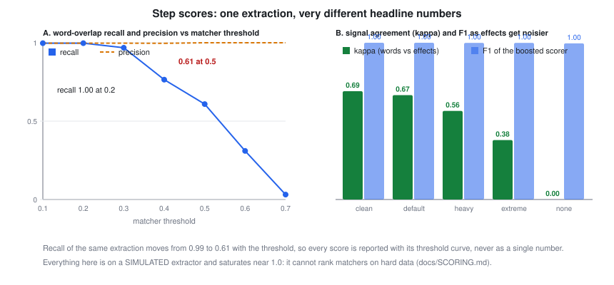

# Step scores: making them coherent without making them less accurate

Handoff's success criterion is a step score: how many of the expert's steps an extractor recovers. That one number was hiding three kinds of incoherence. This page says what we found, what we do now, and, just as important, **what we still do not measure**.

## What was incoherent

1. **A hidden threshold decided the headline.** With one-to-one matching, word overlap reads recall 0.997 at threshold 0.2 and 0.608 at threshold 0.5 on the same extractions, while precision stays above 0.99 [C:step-score-threshold-swing]. A single recall figure without its threshold is not a measurement.
2. **Two signals disagreed and nothing said so.** Word overlap misses paraphrases ("take off the belt") and confuses opposites ("remove the belt" versus "refit the belt"). What a step *does* (requires, adds, removes) sees through wording but depends on the extractor inferring effects correctly.
3. **Averaging them made one case worse.** A fitted weighted average was less accurate than the effect signal alone on a held-out procedure, because the word part pulled in look-alike opposites. Gating on the effect signal was worse than words when effects were noisy. Coherence by naive combination cost accuracy.

## What we do now

- **Optimal one-to-one assignment** (Hungarian), not greedy.
- **Words stay primary; effects only boost** (a small weight, applied only when both steps carry inferred effects). In 5 simulated noise conditions this was never worse than words alone and was better when effects were clean [C:step-score-booster-safe].
- **Report the threshold curve**, not one point, and bootstrap intervals over jobs.
- **Use the agreement between the two signals as a health check.** It falls steadily as the extractor's effects get noisier (about 0.69 clean down to 0 with none), so a low value is an alarm that the effect signal should not be trusted [C:step-signal-agreement].
- **Score order and dependencies too.** Order is recovered well; dependencies are not (below) [C:dependency-recovery-gap].

## What we are not measuring, or not measuring well

| Gap | Why it matters | Status |
|---|---|---|
| **Any real extractor.** Every number above is on a simulated extractor whose noise rates are assumptions | the real error pattern may be nothing like it | not measured; needs the recorded jobs |
| **A benchmark that discriminates.** The synthetic set saturates near 1.0 and cannot tell the matchers apart [C:step-benchmark-saturated] | high scores prove nothing about harder data | need paraphrases with no shared nouns, near-duplicate steps, merged and split steps |
| **Dependency recovery.** About 0.75 on average, worst job 0.33 [C:dependency-recovery-gap] | the verified graph is the product; weak dependencies mean weak gap detection | the largest known weakness |
| **Granularity.** One-to-one matching assumes the expert and the extractor split work the same way | a merged or split step is scored as a miss or an extra | not handled |
| **Step boundaries in time.** Start and end of each step against video and motion data | "recovers the steps" is untested as "finds them in the footage" | not built |
| **Per-step attributes.** Parts, tools, warnings, keyframes | the application promises them | not scored |
| **Calibration.** Does a high match score mean a proportionally high chance the match is correct? | thresholds are only meaningful if scores are calibrated | not measured |
| **Human agreement.** How much do two experts agree on the step list? | it caps any achievable score | not measured |
| **Trainee side.** Alert precision and recall on real trainee runs, false-alarm annoyance, time saved | the second half of the product | verified only on scripted runs |
| **Cost per recovered step** (time, model calls, spend) | the router optimises it, but we have no real figures | not measured |

The application's own criterion, at least 85% of steps on 5 real recorded jobs and every removed step flagged, is still unmeasured: the recordings do not exist yet <!-- no-claim -->. Everything above prepares the instrument; none of it replaces that test.
