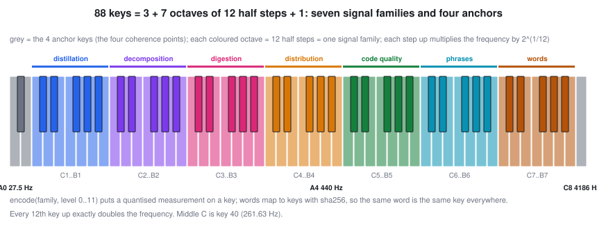
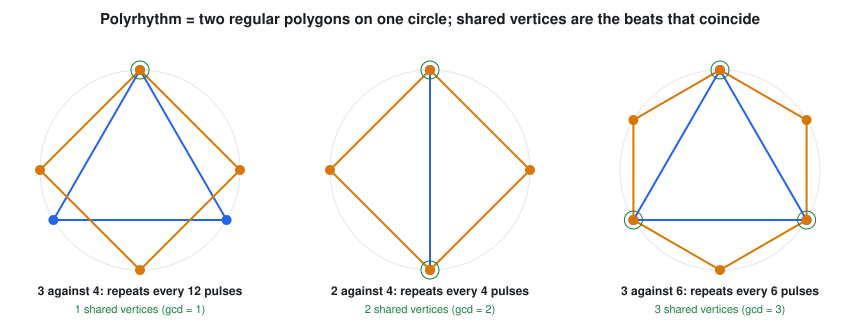

# Sound, rhythm and symmetry: the frequency layer

Measurements are translated into something a person can hear or feel, and the layout is not arbitrary: each piece is defined exactly and checked.

## The 88 keys

Equal temperament: key n sounds at 440 x 2^((n-49)/12) Hz, so A4 is 440 Hz, A0 is 27.5 Hz and C8 is about 4186 Hz; each half step multiplies the frequency by 2^(1/12) and every 12 keys double it [C:keyboard-88-keys].

The layout is **88 = 3 + 7 x 12 + 1**: seven full octaves (C1 to B7) of 12 half steps, plus three keys below them and one above. We use the seven octaves for seven signal families, in the order distillation, decomposition, digestion, distribution, code quality, phrases, words, and the four leftover keys as four anchors, the same count as the four coherence points. A measurement is quantised to one of 12 half steps inside its family's octave. A word becomes a key by a stable hash, identical on every machine and run [C:word-keys-are-deterministic].

## Time signatures and polyrhythm on a geometric clock

A bar of 4/4 has 8 eighth-note pulses, 3/4 has 6, 6/8 has 6 grouped in threes, 7/8 has 7. A polyrhythm a against b repeats after lcm(a, b) pulses, and on the clock circle its two regular polygons share exactly gcd(a, b) vertices: those are the beats that coincide [C:polyrhythm-geometric-clock].

## Four points in perfect symmetry

Four vertices of the 4-cube that are all the same distance apart form a regular tetrahedron in 4-space. The symmetries of the cube rotate them among themselves in every possible order, so none of the four points is special [C:tesseract-four-point-symmetry]. Together with their dual set they make the 8 even-weight vertices. This is the exact meaning of "four coherent points in perfect symmetry" that the rest of the system uses; see [STORY.md](STORY.md).

## What this layer does not do

It does not claim that music theory explains code quality. It is an encoding: stable, invertible where stated, and checked. Whether a person understands a system better when it is sounded this way is hypothesis H2 in [STORY.md](STORY.md), and it is untested with real people.
