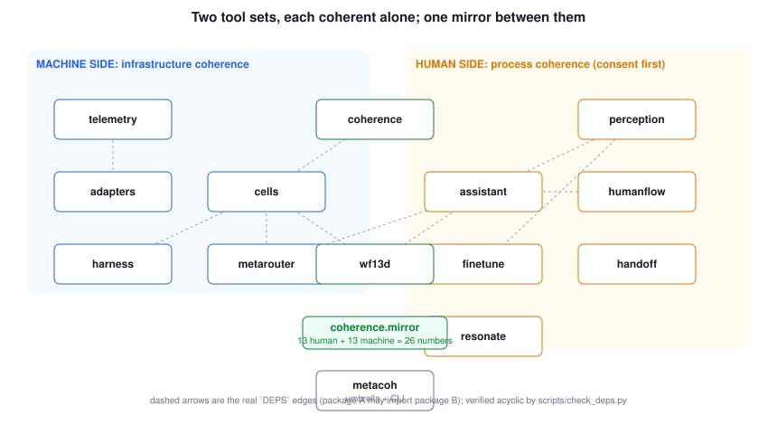
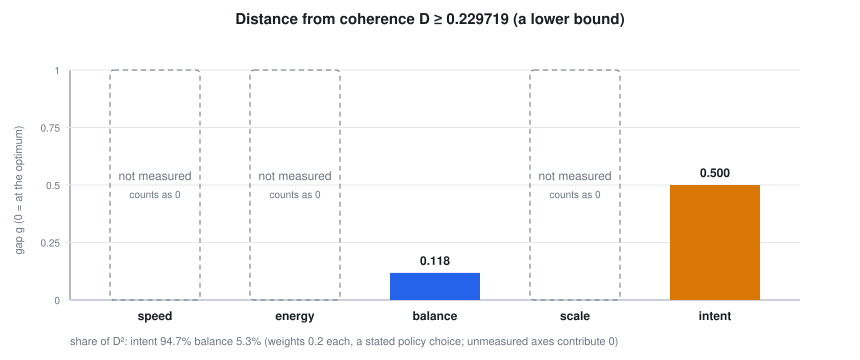
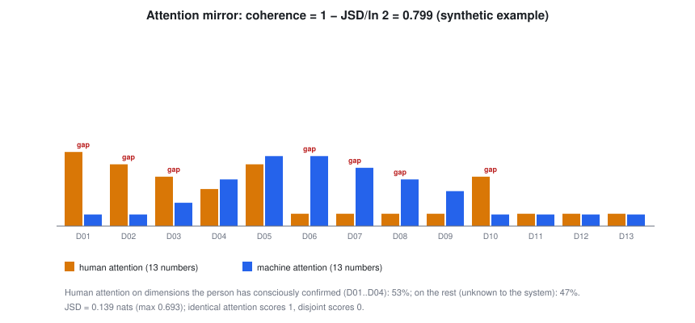
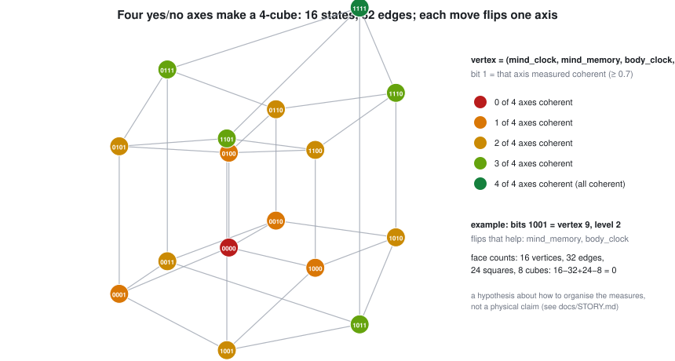
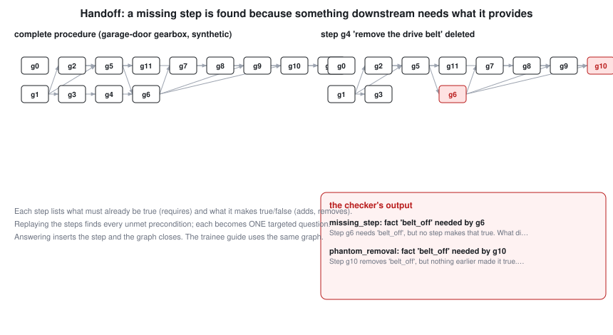

# The story: why one track and one theme were not enough, and what we built instead

Three views of the same events, then an honest map from every metaphor to something the repository measures. Anything we only believe is marked **HYPOTHESIS**. Every number carries a claim tag; see [CLAIMS.md](CLAIMS.md) for the check behind it.

## 1. First person: the author's voice (draft, from the author's own statements; edit freely)

I applied with **Handoff**: capture an expert's hands-on work through Meta AI glasses, turn it into a verified procedure, and guide a trainee through it. Capture, extract, verify, guide. It fit **Push the Frontier**.

Then I started writing the Day 1 spec, and something kept feeling wrong. The rules ask me to choose one track and one theme. *Build for Your World* or *Push the Frontier*. But whichever one I choose, I go blind to the other half of the problem. If I build for my world, I lose sight of the frontier. If I chase the frontier, I lose sight of the person doing the work. And the deeper trouble is that a human who has chosen a direction loses their own location: where my effort is going, what the machines underneath me are doing, whether my intent and my systems actually agree. I cannot see that from the inside.

What I need is two things. First, **measurements I can prove**, so my location is a number and not a feeling. Second, a way for those numbers to reach *me*. If the math is not readable to me, the system should translate it until it lands: a sentence, an analogy, a bar, a tone. The system should adapt to the person; the person should not have to adapt to the math.

So the work split in two. One tool set keeps the **infrastructure** coherent: telemetry, a single distance-from-coherence number, small agents that follow its gradient, rollouts with a control group, a boundary no agent can edit. The other keeps **human process** coherent: consent first, a personal time ledger only I can read, an assistant that respects my focus, and Handoff's procedure graph. Each side can hold itself together alone. When they share a measured state, a mirror of where each side is paying attention, they bond: the machine can see what I have not said, and I can see what the machine has not told me.

## 2. The agent's view (third person)

The agent was asked to make the whole estate measurable and then to package it. It built the arithmetic first, because a claim without a check is only a story.

- It measured one real three-node cluster read-only and computed a distance from coherence of at least **0.2297** [C:distance-lower-bound]. It called that a *lower bound*, because speed, energy and scale had no instruments yet, and an unmeasured axis can never be allowed to flatter the total.
- The largest term was not the machines. About **95%** of the squared distance was the *intent* gap: the system did not know enough about what the author wanted [C:intent-dominates-D]. The machine imbalance was real but small beside it: one node carried **2.08** times its CPU capacity in commitments while another carried **0.58** [C:cpu-commit-imbalance].
- So the highest-value action was not to move a guest. It was to ask the human a question [C:direction-follows-gradient].
- The agent also found its own mistakes and kept them in the record: a gate that demanded 0.67 where the rule meant four of six bits; a false-alarm test that reused one random generator and proved nothing; test data whose hidden factors were redrawn per feature. Each is now a test that would have caught it.

## 3. Drew's view (third person)

Drew runs a three-node cluster with Ceph and Kubernetes, and keeps every irreversible decision for himself. In this build his stated intent was clear on three of the six WF-13D questions: **what** (a coherence system that tells each small agent which way to go), **why** (speed and energy balanced, provably), **how** (policies inside every cell, Meta models only, through one gateway). Who it is for, where it runs and when it is due were left open, and the system recorded them as unknown instead of guessing.

He also changed his mind in the open, and the record treats that as information, not error: first "not for the hackathon", then "package it for the hackathon"; first "not Muse", then "Muse where it is the cheapest model that can do the job"; Muse subscription for interactive use and testing, the gateway for everything else; Rust built on the dev host, never on the workstation. The pattern underneath did not change: **publish nothing, push nothing, and decide nothing irreversible without him**, and make every claim something that can be run.

## 4. Two tool sets, one mirror

| Metaphor | What it is in the code | Proof |
|---|---|---|
| "26 dimensions" | the WF-13D loop has 13 dimensions; one 13-vector of attention per side gives 13 + 13 = 26 numbers | [C:loop-dimensions-13] |
| "a 13-dimensional attention mirror" | `mirror_coherence = 1 - JSD/ln 2` between the human and machine attention vectors; 1 means they attend identically | [C:mirror-properties] |
| "difference between conscious intent and unknowns" | WF-13D bits the human has confirmed versus everything else; the share of attention on confirmed dimensions | [C:intent-dominates-D] |
| "a frequency that resonates with each person" | each person's own format preference (number, bar, sentence, analogy, tone, pulse) learned from their comprehension, plus a tone whose beat vanishes when both sides agree | [C:modality-learning-is-personal] [C:beats-vanish-when-coherent] |
| "4-dimensional tesseract coherence" | four yes/no axes (mind clock, mind memory, body clock, body memory) make a 4-cube: 16 states, one axis flipped per move | [C:tesseract-counts] |
| "tools that each stay coherent alone" | the package graph is acyclic and each package imports only what its `DEPS` allows | [C:release-gates] |
| "escape direction" | Langton's ant run until its pattern locks; the highway direction is the cell's tie-breaker | [C:ant-empty-grid] |
| "cache to cache between cells" | push-pull gossip; 32 cells converge in a handful of rounds | [C:gossip-converges-fast] |
| "locates my effort in provable measurements" | the claims register: every number in these docs is a check that can fail | [C:figures-current] |

## 5. What is metaphor, what is measured, what is not claimed

- "Entangled" means *sharing a measured state*. There is nothing quantum in this repository.
- 26, 13 and 4 are counts of quantities defined in the code. They are not physical dimensions.
- **HYPOTHESIS H1:** the closer a person's attention is to an agent's (higher mirror coherence), the faster and with fewer errors paired tasks complete. **Not tested.** It would be refuted if, across at least thirty paired tasks, mirror coherence showed no relation to completion time or error rate.
- **HYPOTHESIS H2:** presenting a measurement in the format a person has shown they understand fastest reduces their time to act on it. The learning mechanism is verified in simulation; the effect on real people is untested.
- Not built: any study with real people, a verified wearable SDK adapter, energy measurement, a deployed local Meta model.

## 6. One track, one theme: what we actually submit

The Official Rules allow one track and one problem statement per submission. We submit **Indie Developer** and **Push the Frontier**, as in the application. The *Build for Your World* half of the story lives in the design (the person-owned, consent-first side of the mirror); it is not a second entry.

## 7. The original goal, Handoff, and where it stands

| Application step | Where it lives | Status |
|---|---|---|
| Capture: first-person video, audio, motion from Meta AI glasses, hands free | `perception` (consent, redaction, no raw media); the glasses SDK adapter is a stub | adapter **not built**; consent and no-media verified [C:consent-default-deny] [C:no-raw-media-stored] |
| Extract: segment parts and tools, fuse narration into steps | Meta models through the router (`sam-3.1`, Muse Spark) | interface only, **no live call made** |
| Verify: steps as a graph with preconditions and effects; find gaps; ask one question per gap | `handoff.procedure` | implemented; every detectable removal flagged on three synthetic procedures [C:handoff-removal-flagged]; closes with few questions [C:handoff-closes-with-few-questions] |
| Guide: speak up on skipped or out-of-order steps | `handoff.Guide` | verified on synthetic runs [C:handoff-guidance-alerts] |
| Done-when: at least 85% of steps recovered on 5 real jobs and every removed step flagged | needs real recordings | **not yet measured**; the synthetic result above is not that result <!-- no-claim -->

How the step scores themselves can mislead, and what we still do not measure, is in [SCORING.md](SCORING.md): a hidden matcher threshold alone moves recall by more than 0.3 on identical extractions [C:step-score-threshold-swing].

